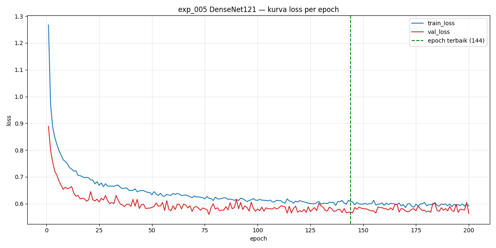
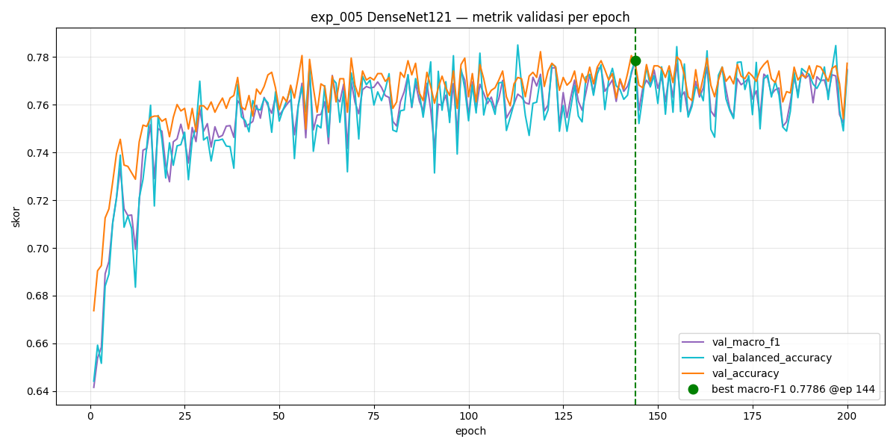
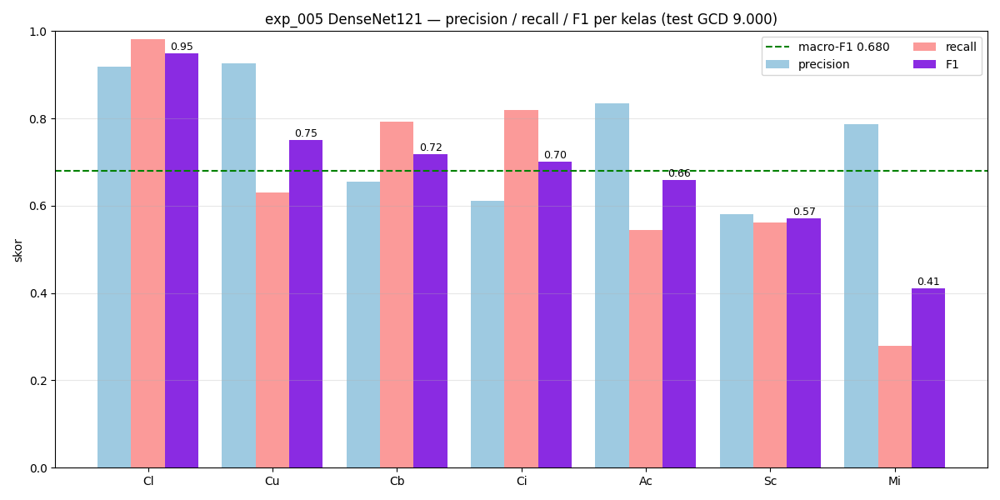
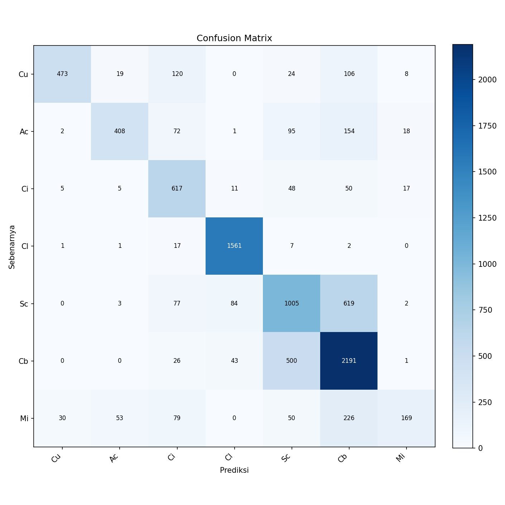

# Analisis Hasil Baseline DenseNet-121 (exp_005)

> **Status: menunggu hasil pelatihan.** Dokumen ini adalah **kerangka analisis**
> yang akan diisi **setelah** `exp_005_densenet121` dijalankan. Angka pada tabel
> ditandai `TBD` (*to be determined*) dan harus diisi **hanya** dari artefak nyata
> di `experiments/exp_005_densenet121/` — bukan perkiraan. Bandingkan dengan
> baseline AlexNet di [`../alexnet/ANALISIS_BASELINE_ALEXNET.md`](../alexnet/ANALISIS_BASELINE_ALEXNET.md).

Analisis hasil pelatihan **transfer learning DenseNet-121** (bobot ImageNet, mode
`feature_extraction`) untuk klasifikasi 7 kelas awan (GCD + CCSN_v2). Setup baseline
(arsitektur, data, konfigurasi): [`BASELINE_DENSENET121.md`](BASELINE_DENSENET121.md).

- Eksperimen: `exp_005_densenet121` · tanggal artefak **TBD**
- Sumber (nyata, bukan perkiraan): `experiments/exp_005_densenet121/`
  — `metrics.json`, `classification_report.txt`, `training_history.csv`,
  `confusion_matrix.png`, `config.yaml`, `notes.md`; checkpoint
  `checkpoints/exp_005_densenet121/best.pt`.
- Rasional pilihan hyperparameter (bersama lintas baseline): [`../alexnet/rasional-hyperparameter.md`](../alexnet/rasional-hyperparameter.md).
- Diagram alur arsitektur (animasi, buka di browser): [`arsitektur-exp005.html`](arsitektur-exp005.html).

---

## 1. Ringkasan eksekutif

| Besaran | Nilai |
|---|---|
| Epoch terbaik (dipilih dari validation) | **TBD** dari 200 |
| val macro-F1 terbaik | **TBD** |
| **Test macro-F1** (metrik primer) | **TBD** |
| Test accuracy (= micro-F1 global) | **TBD** |
| Test balanced accuracy | **TBD** |
| Parameter dilatih / total | 7.175 / **TBD** (head `Linear(1024→7)` saja) |
| Waktu pelatihan | **TBD** |

**Inti temuan:** _(isi setelah run — bandingkan terhadap AlexNet exp_006: test macro-F1 0,5042)._

---

## 2. Konfigurasi yang dievaluasi

Diambil dari `experiments/exp_005_densenet121/config.yaml` (snapshot saat run). Identik dengan AlexNet exp_006 kecuali arsitektur:

| Item | Nilai |
|---|---|
| Arsitektur | `densenet121` (torchvision, pretrained ImageNet) |
| Mode fine-tune | `feature_extraction` (backbone beku, hanya `classifier` 1024→7 dilatih) |
| Input | 512×512 RGB, normalisasi `/255` → [0,1] (mean 0, std 1) |
| Augmentasi | nonaktif |
| Epochs | 200 |
| Batch size | 8 (TBD — konfirmasi dari `notes.md` run) |
| Optimizer | AdamW, lr 1e-4, weight_decay 0,0 |
| Scheduler | — (tidak ada) |
| Penanganan imbalance | `none` (train sudah diseimbangkan 3.000/kelas) |
| Checkpoint | simpan terbaik menurut `val_macro_f1` (mode max) |
| Data | train seimbang 21.000 · val 1.851 · **test resmi GCD 9.000** |

---

## 3. Waktu pelatihan

_(Isi dari stempel waktu artefak / `training_history.csv` setelah run. Loop pelatihan
belum mencatat durasi ke file — lihat catatan metode di analisis AlexNet §3.)_

---

## 4. Dinamika pelatihan (200 epoch)

Sumber: `training_history.csv` (kolom `train_loss`, `val_loss`, `val_macro_f1`,
`val_balanced_accuracy`, `val_accuracy`).

| Epoch | train_loss | val_loss | val_macro_f1 | Keterangan |
|---|---|---|---|---|
| 1 | TBD | TBD | TBD | awal |
| … | … | … | … | … |
| **best** | TBD | TBD | **TBD** | **terbaik → checkpoint** |
| 200 | TBD | TBD | TBD | akhir |

_(Sisipkan grafik setelah run:)_
<!--  -->
<!--  -->

---

## 5. Evaluasi test — semua metrik

Test dihitung **sekali** memakai checkpoint terbaik (dipilih dari validation,
**bukan** test). Sumber: `metrics.json` + `classification_report.txt`.

### 5.1 Metrik global

| Metrik | Nilai | Catatan |
|---|---|---|
| Accuracy (= micro-F1) | TBD | |
| **Macro-F1** (primer) | **TBD** | |
| Balanced accuracy | TBD | |
| Weighted-F1 | TBD | |
| Macro precision / recall | TBD / TBD | |

### 5.2 F1 per kelas (precision / recall / F1 / support)

Sumber: `metrics.json → test.per_class`.

| Kelas | Precision | Recall | **F1** | Support |
|---|---|---|---|---|
| Cu | TBD | TBD | TBD | 750 |
| Ac | TBD | TBD | TBD | 750 |
| Ci | TBD | TBD | TBD | 753 |
| Cl | TBD | TBD | TBD | 1.589 |
| Sc | TBD | TBD | TBD | 1.790 |
| Cb | TBD | TBD | TBD | 2.761 |
| Mi | TBD | TBD | TBD | 607 |

_(Sisipkan grafik setelah run:)_
<!--  -->

### 5.3 Confusion matrix

Baris = kelas sebenarnya, kolom = prediksi (urutan Cu, Ac, Ci, Cl, Sc, Cb, Mi).

<!--  -->

---

## 6. Perbandingan dengan AlexNet (exp_006)

| Metrik | AlexNet exp_006 | DenseNet-121 exp_005 |
|---|---|---|
| Test macro-F1 | 0,5042 | **TBD** |
| Test accuracy | 0,5782 | **TBD** |
| Test balanced accuracy | 0,4865 | **TBD** |
| Parameter trainable | 28.679 | 7.175 |

_(Analisis naratif perbandingan diisi setelah run — apakah kedalaman + dense
connectivity DenseNet mengangkat kelas bertekstur halus Sc/Ci/Mi yang lemah di AlexNet.)_

---

## 7. Diagnosis & rekomendasi

_(Isi setelah run.)_

---

## 8. Reproduksibilitas

- Metrik & angka harus seluruhnya berasal dari artefak `experiments/exp_005_densenet121/`
  dan `checkpoints/exp_005_densenet121/best.pt` (seed 42).
- Evaluasi ulang test dari checkpoint:
  `python scripts/train.py --config configs/experiments/exp_005_densenet121.yaml`
  (atau jalankan Sel 6 di [`notebooks/05_densenet121_training.ipynb`](../../../notebooks/05_densenet121_training.ipynb)).
- Protokol split, kontrak keluaran, dan aturan eksperimen:
  [`TRAINING_GUIDE.md`](../TRAINING_GUIDE.md); rencana lengkap: [`EXPERIMENT_PLAN.md`](../EXPERIMENT_PLAN.md).
