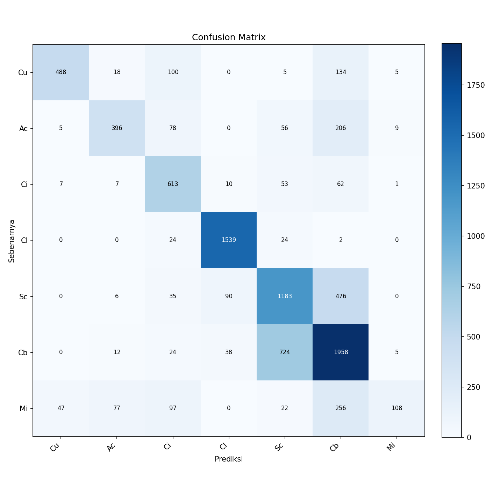

# Analisis Training dari Awal DenseNet-121

> **Status: pelatihan 10/10 epoch dan evaluasi test selesai.**
> Analisis diperbarui dari artefak train, validation, dan test.
> Pembaruan: 22 Oktober 2026 (Asia/Jakarta).

Eksperimen: `exp_005b_densenet121_scratch`.  
Metode dan hyperparameter: [Informasi training dari awal](training-dari-awal.md).

## 1. Ringkasan hasil

DenseNet-121 yang dilatih dari bobot acak mencapai validation macro-F1 terbaik
**0,7793** pada **epoch 10**. Riwayat memuat seluruh epoch 1–10, sesuai jumlah
epoch pada konfigurasi efektif. Epoch terbaik dan nilai macro-F1 tertinggi
pada CSV cocok dengan ringkasan `metrics.json`.

| Besaran | Hasil |
|---|---:|
| Epoch selesai | 10 dari 10 |
| Epoch terbaik menurut validation macro-F1 | **10** |
| Validation macro-F1 terbaik | **0,779281** |
| Validation accuracy pada epoch terbaik | **0,794706 (79,47%)** |
| Validation balanced accuracy pada epoch terbaik | **0,772761 (77,28%)** |
| Train loss pada epoch terbaik | 0,473754 |
| Validation loss pada epoch terbaik | 0,549205 |
| Parameter dilatih / total | 6.961.031 / 6.961.031 |
| Test macro-F1 | **0,658259** |
| Test accuracy | **0,698333 (69,83%)** |
| Test balanced accuracy | **0,644180 (64,42%)** |

Hasil ini menunjukkan model mempelajari pola yang berguna untuk klasifikasi
pada validation set. Pada test resmi GCD, macro-F1 mencapai **0,6583**;
kelemahan utama terdapat pada kelas Mi serta kekeliruan antara Sc dan Cb.

## 2. Sumber bukti

| Sumber | Pemeriksaan |
|---|---|
| [Konfigurasi run](../../../../../experiments/exp_005b_densenet121_scratch/config.yaml) | Bobot acak, mode full, 10 epoch, batch 8, AdamW 1e-4 |
| [Arsitektur model](../../../../../experiments/exp_005b_densenet121_scratch/model_architecture.txt) | Total dan trainable sama-sama 6.961.031 |
| [Riwayat pelatihan](../../../../../experiments/exp_005b_densenet121_scratch/training_history.csv) | Epoch 1–10 lengkap; sumber utama tabel dan perhitungan |
| [Ringkasan metrik](../../../../../experiments/exp_005b_densenet121_scratch/metrics.json) | `best_epoch: 10`, `best_val_metric: 0.7792808644007313`, hasil test tersedia |
| [Notebook](../../../../../notebooks/tahap_pre_training/05b_densenet121_pre_trainning.ipynb) | Output menyatakan selesai dan menampilkan progres semua epoch |
| `checkpoints/exp_005b_densenet121_scratch/best.pt` | Berkas tersedia; output trainer melaporkan checkpoint terbaik pada epoch 10 |
| [Laporan klasifikasi](../../../../../experiments/exp_005b_densenet121_scratch/classification_report.txt) dan [confusion matrix](../../../../../experiments/exp_005b_densenet121_scratch/confusion_matrix.png) | Tersedia; jumlah support dan matriks cocok dengan 9.000 sampel |

Isi biner checkpoint tidak dimuat ulang dalam pemeriksaan dokumentasi ini.
Kesesuaian epoch terbaik diverifikasi melalui CSV, JSON, dan output notebook.
Angka tabel dibulatkan untuk penyajian; selisih dihitung dari presisi penuh CSV.

## 3. Konfigurasi yang dianalisis

| Pengaturan | Nilai |
|---|---|
| Arsitektur | DenseNet-121, torchvision |
| Bobot awal | Acak; `pretrained: false` → `weights=None` |
| Parameter yang dilatih | Seluruh backbone dan classifier; `finetune: full` |
| Classifier | `Linear(1024, 7)` |
| Train / validation / test | 21.000 / 1.851 / 9.000 citra |
| Kelas | Cu, Ac, Ci, Cl, Sc, Cb, Mi |
| Input | 512 × 512 RGB |
| Normalisasi | /255 ke [0, 1]; tanpa standardisasi ImageNet |
| Epoch / batch size | 10 / 8 |
| Optimizer / learning rate | AdamW / **0,0001** |
| Weight decay / scheduler | 0 / tidak ada |
| Loss | CrossEntropyLoss tanpa bobot kelas |
| Random seed / workers | 42 / 0 |
| Pemilihan checkpoint | Validation macro-F1 tertinggi |
| Perangkat pada output notebook | NVIDIA GeForce RTX 4060 Laptop; PyTorch 2.1.1+cu121 |

Train telah diseimbangkan menjadi 3.000 citra per kelas, termasuk augmentasi
yang dimaterialisasi sebelumnya. Tidak ada augmentasi tambahan saat pemuatan
data. Validation dan test menggunakan distribusi split yang sudah tersedia.

## 4. Riwayat lengkap pelatihan

Sumber: `training_history.csv`. Train loss merupakan rata-rata loss selama
pembaruan bobot dalam satu epoch; validation dihitung setelah epoch berakhir.

| Epoch | Train loss | Val loss | Val macro-F1 | Val balanced accuracy | Val accuracy |
|---|---:|---:|---:|---:|---:|
| 1 | 1,1055 | 0,8367 | 0,6439 | 0,6339 | 0,6829 |
| 2 | 0,8552 | 0,7293 | 0,6904 | 0,6815 | 0,7169 |
| 3 | 0,7524 | 0,7329 | 0,6762 | 0,6524 | 0,7158 |
| 4 | 0,6894 | 0,7344 | 0,7148 | 0,7331 | 0,7304 |
| 5 | 0,6358 | 0,6119 | 0,7623 | 0,7858 | 0,7688 |
| 6 | 0,5925 | 0,6659 | 0,7346 | 0,7256 | 0,7472 |
| 7 | 0,5593 | 0,5958 | 0,7647 | 0,7574 | 0,7720 |
| 8 | 0,5199 | 0,5812 | 0,7722 | 0,7636 | 0,7812 |
| 9 | 0,4983 | 0,6946 | 0,6939 | 0,6890 | 0,7515 |
| **10** | 0,4738 | 0,5492 | **0,7793** | 0,7728 | 0,7947 |

Epoch 10 sekaligus memiliki validation loss terendah, validation macro-F1
tertinggi, dan validation accuracy tertinggi pada run ini. Validation balanced
accuracy tertinggi justru terdapat pada **epoch 5 (0,7858)**. Checkpoint tetap
dipilih berdasarkan macro-F1, sesuai kriteria yang ditetapkan sebelum training.

## 5. Analisis dinamika pelatihan

### 5.1 Perkembangan loss dan macro-F1

Train loss turun secara monoton dari **1,1055** menjadi **0,4738**, berkurang
sekitar **57,14%** dari nilai epoch pertama. Validation loss turun dari
**0,8367** menjadi **0,5492**, berkurang sekitar **34,36%**, meskipun mengalami
fluktuasi di tengah pelatihan.

Validation macro-F1 meningkat dari **0,6439** menjadi **0,7793**:
kenaikan absolut **0,1353**, atau **13,53 poin persentase**. Perbaikan terjadi
pada train dan validation, sehingga penurunan loss train tidak hanya disertai
peningkatan kemampuan pada data latih.

### 5.2 Fluktuasi epoch 9

Pada epoch 9, train loss masih turun menjadi 0,4983, tetapi validation loss
naik dari 0,5812 menjadi **0,6946**. Validation macro-F1 turun dari 0,7722
menjadi **0,6939**, atau **7,83 poin persentase** dibanding epoch 8.

Pada epoch 10, validation macro-F1 pulih menjadi **0,7793**, naik **8,54 poin
persentase** dari epoch 9, dan validation loss mencapai nilai terendah run.
Penurunan satu epoch tersebut tidak cukup untuk menyimpulkan overfitting
yang berkelanjutan. Penyebab khusus fluktuasi tidak dapat ditentukan dari
metrik agregat yang tersedia.

### 5.3 Generalisasi dan konvergensi

Selisih validation loss terhadap train loss pada epoch 10 adalah **0,0755**.
Keduanya dihitung pada kondisi berbeda: train loss dirata-ratakan saat bobot
terus diperbarui dalam mode training, sedangkan validation dihitung dengan
bobot akhir epoch dalam mode evaluasi. Selisih tersebut perlu dibaca bersama
tren seluruh riwayat.

Tidak terlihat penurunan validation yang terus berlanjut sampai akhir run.
Namun, bukti ini belum cukup untuk menyatakan model bebas overfitting atau
telah konvergen. Checkpoint terbaik berada pada batas akhir anggaran 10 epoch,
sehingga kemungkinan manfaat tambahan epoch masih terbuka dan harus diuji
menggunakan validation.

## 6. Waktu pelatihan yang tercatat

Output progress bar notebook mencatat durasi berikut, dalam detik:

| Epoch | Durasi progress bar |
|---|---:|
| 1 | 1.958 |
| 2 | 1.941 |
| 3 | 1.496 |
| 4 | 1.275 |
| 5 | 1.241 |
| 6 | 1.274 |
| 7 | 1.286 |
| 8 | 1.489 |
| 9 | 1.737 |
| 10 | 1.605 |

Jumlah durasi yang ditampilkan adalah **15.302 detik**, sekitar
**4 jam 15 menit 2 detik**, dengan rata-rata sekitar **25 menit 30 detik per
epoch**. Ini merupakan penjumlahan waktu progress bar yang dibulatkan,
bukan pengukuran durasi keseluruhan sesi menggunakan waktu mulai dan selesai.
Persiapan data/model, penulisan checkpoint setelah bar ditutup, serta aktivitas
di luar loop tidak tercakup sebagai durasi sesi yang terverifikasi.

## 7. Konteks terhadap baseline ImageNet

[Artefak baseline ImageNet](../../../../../experiments/exp_005_densenet121/metrics.json)
mencatat validation macro-F1 terbaik **0,778583** pada epoch **144**.
Run dari awal ini mencapai **0,779281** pada epoch **10**, selisih sekitar
**+0,000698**, atau **+0,07 poin persentase**.

Angka tersebut hanya perbandingan deskriptif. Menurut
[dokumentasi baseline](../../ANALISIS_BASELINE_DENSENET121.md), baseline memakai
200 epoch dan melatih 7.175 parameter classifier dengan backbone beku;
run dari awal memakai 10 epoch dan melatih seluruh 6.961.031 parameter.
Perbedaan inisialisasi, cakupan parameter yang diperbarui, dan anggaran epoch
membatasi atribusi penyebab selisih hasil.

Selisih yang kecil pada satu run tidak membuktikan keunggulan metode secara
statistik. Perbandingan di bagian ini dibatasi pada validation; hasil test run
ini dibahas secara terpisah di bawah. Baseline lama `exp_005` berbeda dari
pendekatan 2 baru `exp_005c`, yang belum memiliki artefak hasil saat pemeriksaan.

## 8. Evaluasi test dan analisis per kelas

Sumber: hasil test pada `metrics.json` dan `classification_report.txt`.
Matriks berjumlah **9.000 citra**, dengan **6.285 prediksi benar**; accuracy
6.285/9.000 sesuai nilai **69,83%** yang disimpan.

| Kelas | Precision | Recall | F1 | Support |
|---|---:|---:|---:|---:|
| Cu | 0,8921 | 0,6507 | 0,7525 | 750 |
| Ac | 0,7674 | 0,5280 | 0,6256 | 750 |
| Ci | 0,6313 | 0,8141 | 0,7111 | 753 |
| Cl | 0,9177 | 0,9685 | 0,9424 | 1589 |
| Sc | 0,5723 | 0,6609 | 0,6134 | 1790 |
| Cb | 0,6328 | 0,7092 | 0,6688 | 2761 |
| Mi | 0,8438 | 0,1779 | 0,2939 | 607 |

Kelas **Cl** memiliki F1 tertinggi (**0,9424**) dan recall **0,9685**.
Kelas **Mi** memiliki F1 terendah (**0,2939**) serta recall **0,1779**:
hanya 108 dari 607 citra Mi dikenali dengan benar. Precision Mi sebesar
0,8438 menunjukkan sebagian besar prediksi Mi benar, tetapi model melewatkan
banyak citra yang sebenarnya Mi.

Kekeliruan penting pada confusion matrix (baris = kelas sebenarnya,
kolom = prediksi):

| Kelas sebenarnya → prediksi | Jumlah citra |
|---|---:|
| Cb → Sc | 724 |
| Sc → Cb | 476 |
| Mi → Cb | 256 |
| Ac → Cb | 206 |
| Cu → Cb | 134 |

Pasangan Sc dan Cb menyumbang **1.200 kekeliruan dua arah**. Tabel mengidentifikasi
pola prediksi; penyebab visual memerlukan pemeriksaan citra dan tidak dapat
dipastikan dari metrik agregat saja.

Test macro-F1 **0,6583** lebih rendah daripada validation macro-F1 **0,7793**
sebesar **12,10 poin persentase**. Validation memakai split gabungan, sedangkan
test berasal dari GCD resmi. Perbedaan sumber/distribusi dapat berkontribusi,
tetapi data ini tidak membuktikan satu penyebab khusus maupun meniadakan
kemungkinan overfitting. Accuracy yang lebih tinggi daripada macro-F1 dan
balanced accuracy juga perlu dibaca bersama ketidakseimbangan support kelas.

## 9. Kesimpulan

Training dari awal DenseNet-121 berhasil menyelesaikan **10 epoch** dan
menghasilkan checkpoint terbaik pada **epoch 10**, dengan validation macro-F1
**0,7793**, balanced accuracy **0,7728**, dan accuracy **0,7947**.
Loss train dan validation turun dibanding awal pelatihan, dengan fluktuasi
validation yang paling nyata pada epoch 9 dan pemulihan pada epoch 10.

Analisis train, validation, dan test untuk run ini sudah mencakup artefak yang
tersedia. Test macro-F1 **0,6583** dan recall Mi yang rendah menunjukkan masih
ada keterbatasan generalisasi. Perbandingan akhir dengan pendekatan 2 menunggu
hasil `exp_005c_densenet121_imagenet`, dengan tetap menyebut perbedaan cakupan
parameter yang dilatih.
